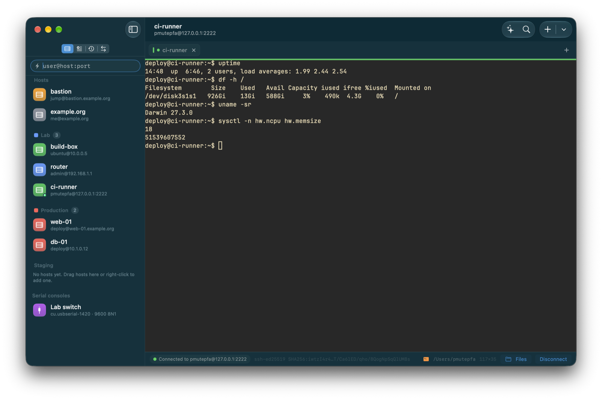
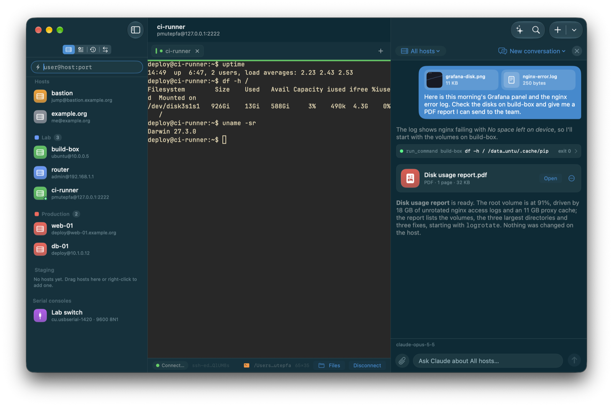
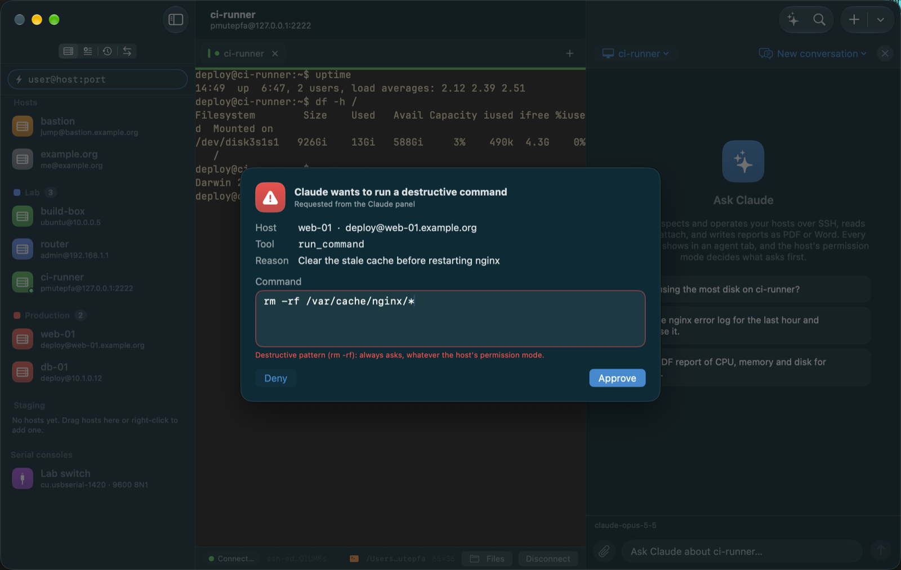
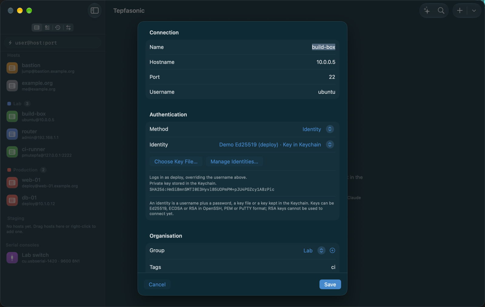
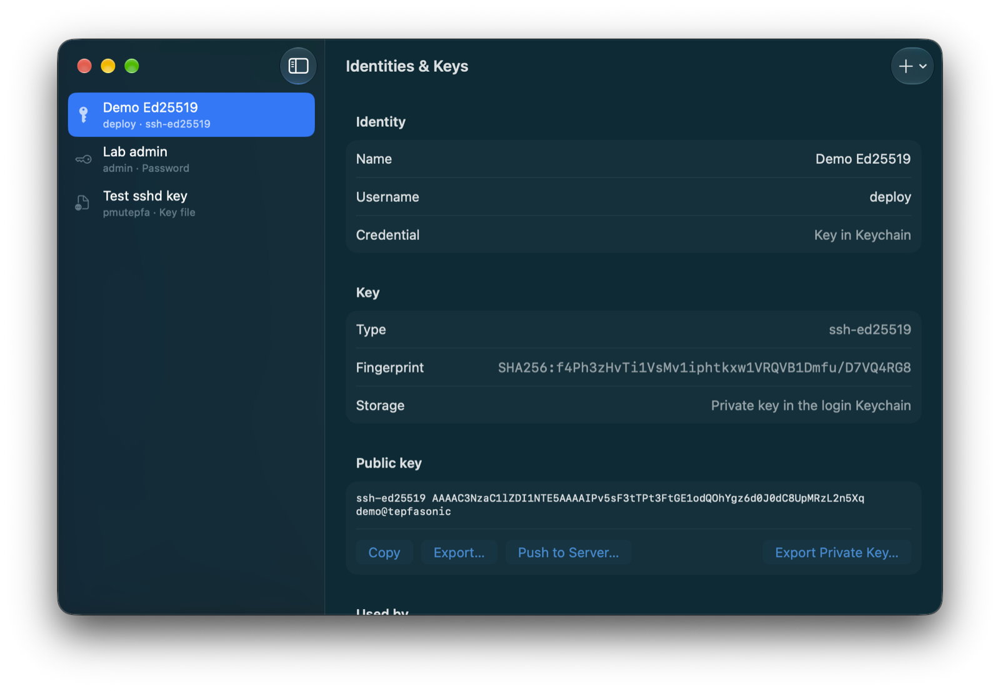
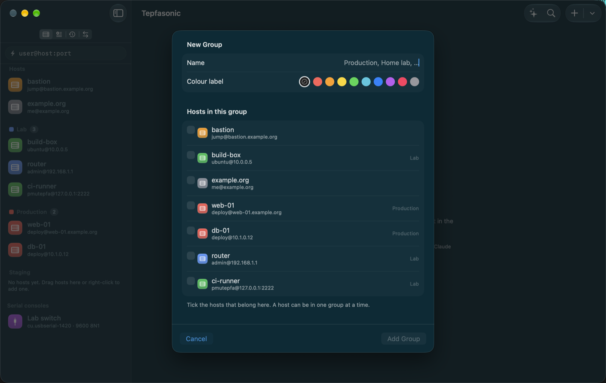
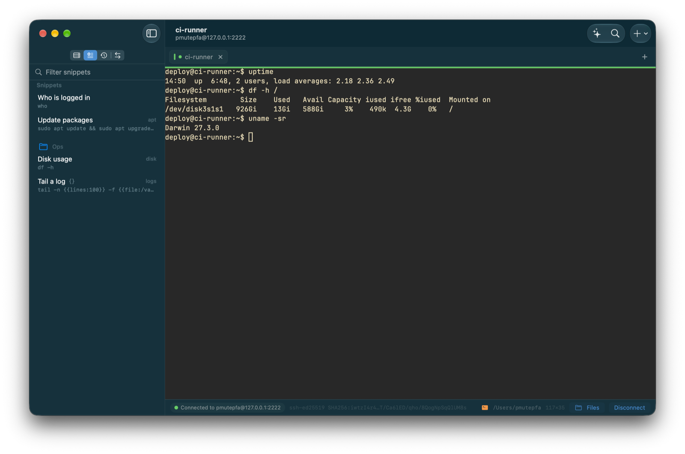
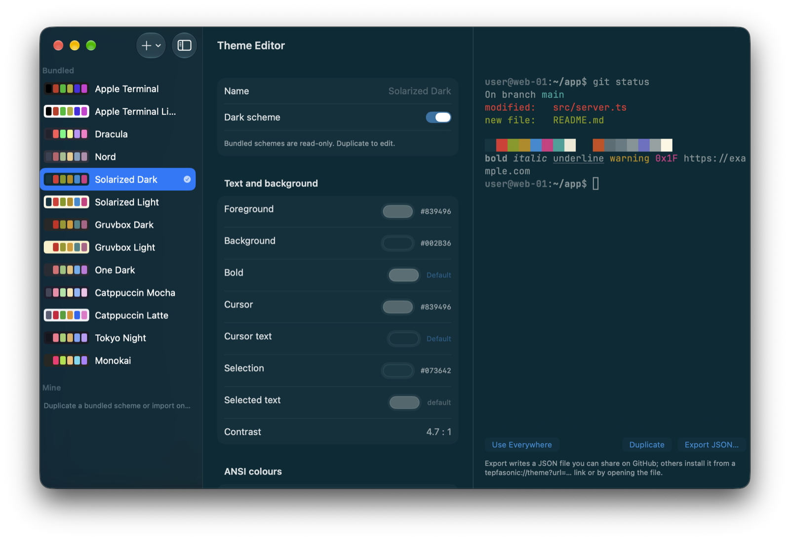
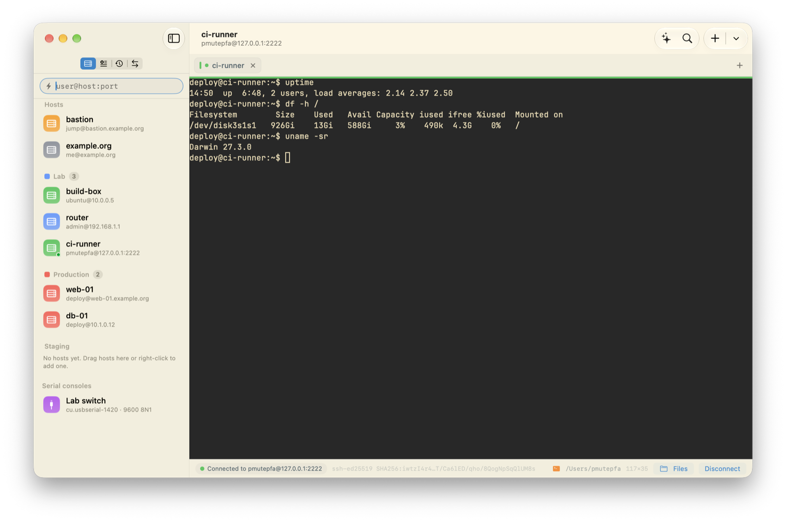

# Tepfasonic Client

A free, open-source DevOps and AIOps tool for macOS: an SSH client and
terminal with a built-in Claude agent, made for managing large fleets of
servers. Group hosts into projects, run and audit commands across them, and
let Claude inspect, operate and report on them. No account, no sync server:
your hosts live in a local database and move between Macs as an encrypted
`.tepfa` file. The full plan is in
[docs/PLAN.md](docs/PLAN.md).

**Status:** all ten build steps are implemented (SSH transport, terminal, host
list, tabs and splits, CI with Sparkle updates, Keychain vault with Touch ID
and key management, snippets and history, export/import, Claude agent panel
and MCP server, port forwarding, SFTP, serial consoles and cloud imports), plus
jump hosts, proxies and theming. Builds are published on the
[download page](https://edwardrem.github.io/Tepfasonic-Client/download/) and
[GitHub Releases](https://github.com/Edwardrem/Tepfasonic-Client/releases);
see "Known limits" for what the libraries underneath cannot do.

## Screenshots

Every screenshot runs against a demo fleet: made-up hosts, keys and
conversations. Your real hosts never leave your Mac.



*Your whole fleet in one window: grouped hosts, tabs and splits, a true-colour terminal, and a jump host for boxes only reachable through a bastion.*

| | |
|---|---|
|  |  |
| **AIOps, built in.** Ask Claude about one host or a whole group. It reads logs, runs commands over SSH behind your guardrails, and writes a PDF or Word report. | **You stay in control.** Destructive commands like `rm -rf` always ask first, whatever a host's permission mode, and you can edit the command before it runs. |
|  |  |
| **Every host, your way.** Hostname, port, identity, jump host, group, tags and colour. Keys stay in the login Keychain. | **Keys in one place.** Generate or import SSH identities, push a public key to a server, keep private keys behind Touch ID. |
|  |  |
| **Organise the fleet.** Build groups like Production or Home lab, tick the hosts that belong, colour-code them, drag to re-sort. | **Run it again in a keystroke.** Reusable command snippets with fill-in placeholders, sorted into folders, one click from any terminal. |
|  |  |
| **Make it yours.** Ten bundled terminal themes or your own, with a live preview. Export a theme as JSON to share. | **Light or dark.** The whole app, sidebar and window chrome follow your terminal colour scheme and the system appearance. |

## What works today

- **Host manager**: hosts with groups, tags, colour labels, notes, a snippet to
  run on connect, per-host theme and font, a background tint and a watermark
  for production boxes. Groups are projects: create them from the sidebar's
  `+` menu, ⇧⌘N or a host's *Move to Group → New Group…*, tick the hosts that
  belong in the group editor, drag hosts between groups or onto a group
  header, reorder hosts and groups, collapse groups, and add a host straight
  into a group from its context menu. Groups set defaults (identity, jump
  host, proxy, theme, font) that hosts inherit unless they override them.
  Quick-connect (`user@host:port`) with an offer to save afterwards, ⌘K search
  across hosts, serial consoles, snippets and history, and a context menu with
  connect, connect in new window, browse files, port forwarding, duplicate,
  edit, move to group and delete.
- **Identities & Keys** window (⌘⇧I): generate Ed25519, ECDSA P-256/384/521 and
  RSA 3072/4096 keys; import OpenSSH, PEM (PKCS#1, PKCS#8, SEC1) and PuTTY
  `.ppk` (v2 and v3) keys from a file or the clipboard; copy or export the
  public key; export the private key in OpenSSH format; push a key to a
  server's `authorized_keys` the way `ssh-copy-id` does. Private keys and
  passwords live only in the login Keychain behind a vault unlocked with
  Touch ID, Apple Watch or the login password, locked again after a
  configurable idle time, on sleep and on screen lock.
- **Terminal** (SwiftTerm): xterm-256color, true colour, Unicode and emoji,
  ligatures, bracketed paste, mouse reporting, 100 000 lines of scrollback,
  clickable URLs and file paths (⌘-click by default), find in buffer (⌘F),
  copy on select, a warning before pasting several lines, auto-reconnect with
  back-off after sleep or a dropped network, and tabs that are restored on
  relaunch. Tabs split right (⌘D) and down (⇧⌘D) into nested panes with
  ⌘-arrow navigation; tabs show the host colour and a status dot.
- **Jump hosts and proxies**: any host can name another as its bastion,
  chained as deep as needed; the target's SSH stream is multiplexed through
  a direct-tcpip channel of the bastion, never a shell. HTTP CONNECT and
  SOCKS5 proxies (with optional username and Keychain password) apply per
  host or per group. Each hop asks for its own password or host-key decision.
- **Snippets** (⌘⇧S): saved commands in folders with tags, notes and
  `{{name}}` / `{{name:default}}` placeholders asked for at run time; run in
  the current tab, every tab, on a host or across a whole group. Shell
  integration (OSC 133 hooks for bash and zsh) records every command with its
  exit status into a searchable global **History** (⌘Y), and inline
  **suggestions** complete from history and snippets while typing.
- **Port forwarding** (⌘⇧P): local, remote and dynamic (SOCKS5) rules tied
  to a host. Rules start with one click or automatically when the host
  connects, show live status, byte counts and open connections, and keep
  working across reconnects: local and SOCKS listeners stay open and use the
  host's current connection, remote listeners are re-requested on the new
  one. ssh-style specs (`8080:localhost:80`) fill the editor.
- **SFTP** (⌥⌘O, the Files button in the status bar, or the host's context
  menu): a dual-pane browser. Either pane can show this Mac or any saved host,
  so server-to-server copies go through the Mac. Drag between panes or from
  the Finder, a transfer queue with progress, speed, pause, resume and
  cancel, folder uploads and downloads, rename, chmod with an octal field,
  delete, new folder, show hidden files, and Open / Open With… for remote
  files, which are uploaded again whenever the editor saves them. Transfers
  pipeline 16 requests of 32 KiB and resume from where they stopped.
- **Claude agent panel** (⌘⇧A): bring your own Anthropic API key (Keychain) or
  point the panel at any OpenAI-compatible endpoint. Dictate a message with the
  microphone button: speech is transcribed on your Mac (nothing leaves it) and
  lands in the composer to edit and send. Attach files to a message
  with the paperclip or by dropping them on the panel: images, PDFs, Word
  documents (sent as their text) and text files such as logs, configs, code
  and CSV go to the model with your question. Ask for a report and Claude
  writes it with `create_document` as PDF (paginated, with headings, lists,
  tables and code blocks), Word `.docx`, HTML, Markdown, text or CSV; the file
  lands in `Agent/Documents` under the app's data folder and shows up as a
  card with Open, Show in Finder and Save As…. Claude also gets `list_hosts`,
  `run_command`, `read_file`, `write_file`, `sftp_transfer` and
  `read_terminal_buffer`, runs commands in a dedicated agent tab you can watch
  and stop with Esc, and conversations are saved per host or group.
- **Guardrails**: each host is read-only (a safe list such as `ls`, `cat`,
  `systemctl status`), ask (every command in an approval sheet) or allowlist
  (your patterns run, everything else asks). Destructive patterns (`rm -rf`,
  `dd`, `mkfs`, `DROP`, `shutdown`, pipes into a shell, …) always ask. The
  sheet shows the exact command, the host and Claude's reason with Approve,
  Edit and Deny. Terminal output reaches the model wrapped as untrusted data.
  An audit log records every agent command with host, time, decision and exit
  status, exportable as JSON.
- **MCP server**: the same tools over the Model Context Protocol (streamable
  HTTP on localhost with a bearer token, plus a stdio bridge inside the app
  bundle) so Claude Desktop, Claude Code or any MCP client drive your servers
  with their own subscription. Settings → Claude shows the one-line config for
  each client. The guardrails and audit log apply identically.
- **Serial consoles**: saved profiles for `/dev/cu.*` devices with baud rate,
  data bits, parity, stop bits, flow control, what Return sends, LF → CR LF
  conversion, local echo and a hex view (toggled in the status bar). Serial
  sessions use the same tabs, splits, snippets and history as SSH and reopen
  the device after it is unplugged and plugged back in.
- **Theming** (Settings → Appearance, Theme Editor in the View menu): 13
  bundled schemes (Apple Terminal light and dark, Dracula, Nord, Solarized
  Light and Dark, Gruvbox Light and Dark, One Dark, Catppuccin Mocha and
  Latte, Tokyo Night, Monokai). The editor shows a live sample terminal while
  colours are picked, and imports iTerm2 `.itermcolors`, Windows Terminal
  JSON, VS Code themes, Alacritty TOML or YAML and Ghostty configs; any scheme
  exports as JSON, and `tepfasonic://theme?url=…` links (the gallery on the
  site uses them) install a scheme after a preview. JetBrains Mono is bundled
  as the default font; any installed monospace family, size, line height,
  ligatures on or off, bold and italic faces. Block, bar or underline cursor
  with or without blink, anti-aliasing, a minimum contrast ratio so dark text
  on dark backgrounds stays readable, background opacity with blur. The scheme
  colours the whole app, not just the terminal: the sidebar, tab bar, status
  bar, Claude panel, cards, sheets and every window background are derived
  from the scheme's own colours (Solarized Light gives a cream sidebar and the
  Solarized blue as accent), with a switch in Settings → Appearance to go back
  to the standard macOS materials. Every window also goes light or dark with
  the scheme in use by default, or follows the system appearance, or stays
  light or dark; the accent is the scheme's, the system's or a custom one, and
  the sidebar is compact or comfortable. A light
  and dark scheme pair swaps with the macOS appearance or on a schedule. Hosts
  and groups override the scheme and font; a badge in a terminal corner shows
  the host, user and session uptime. Themes travel in `.tepfa` files.
- **Export / import** (⌘⇧E / ⌘⇧O): one `.tepfa` file carries hosts, groups,
  identities, snippets, port-forwarding rules, themes, serial profiles and
  trusted host keys, encrypted by default with a passphrase (Argon2id then
  ChaCha20-Poly1305, both implemented in Swift). An encrypted export can also
  carry saved passwords, private keys, passphrases and proxy passwords; a
  plain export never contains secrets. Importing lists every record as new,
  changed (with the fields that differ) or identical, lets you choose per
  record, and snapshots the current data first. Records carry stable UUIDs so
  repeated imports never create copies, and a team can keep a shared file in
  Git or a shared drive and re-import it.
- **Interop**: import from `~/.ssh/config` (following `Include`), Termius
  CSV, PuTTY sessions and Tabby, and from **AWS EC2, DigitalOcean and Azure**
  (Settings → Cloud holds read-only credentials in the Keychain; File →
  Import From → Cloud Provider lists instances with tags and public/private
  IPs and adds the chosen ones through the reviewed import). Export saved
  hosts into a managed block of `~/.ssh/config`.
- **Backups**: the last 10 exports and pre-import snapshots are kept under
  Application Support → Tepfasonic → Backups and listed in Settings → Data.
- **Updates**: Sparkle 2 fed by an appcast on GitHub Pages, with a
  download-only fallback while builds are ad-hoc signed, and an optional beta
  channel.

## Known limits

- SwiftNIO SSH, the transport underneath, signs only with Ed25519 and ECDSA
  keys and ships AES-GCM ciphers. RSA keys can be generated, imported,
  exported and pushed but not used to connect; SSH agent forwarding,
  agent-held keys, FIDO2 security keys and chacha20-poly1305 are not
  available for the same reason.
- Keys kept only in the Keychain cannot be written to `~/.ssh/config`,
  because `ssh` cannot read them.
- Shell integration needs bash or zsh as the login shell; prompts that
  rebuild `PS1` on every prompt lose the input marker, in which case commands
  are still recorded from keystrokes.
- Letter spacing is stored but the terminal engine does not stretch glyph
  cells; line height, ligatures, cursor, contrast and opacity do apply.
- IP addresses are not highlighted separately from URLs and paths.
- Dragging a remote file straight to the Finder is not supported; drop it on
  the local pane (or use Copy to Left) instead.
- The app is not sandboxed yet, so reading keys in `~/.ssh`, serial devices
  and open-with work without entitlements; revisit before App Store
  distribution.

## Building

Requires Xcode 26 or later (Swift 6, macOS 15 SDK) and
[XcodeGen](https://github.com/yonaskolb/XcodeGen).

```sh
brew install xcodegen
xcodegen generate            # writes Tepfasonic.xcodeproj (git-ignored)
open Tepfasonic.xcodeproj    # then Run
```

From the command line:

```sh
xcodebuild -project Tepfasonic.xcodeproj -scheme Tepfasonic -configuration Debug \
  -derivedDataPath .build/DerivedData -skipPackagePluginValidation -skipMacroValidation build
open .build/DerivedData/Build/Products/Debug/Tepfasonic.app
```

Builds are ad-hoc signed until a Developer ID certificate is available, so
Gatekeeper asks for a right-click → Open the first time (or
`xattr -dr com.apple.quarantine /Applications/Tepfasonic.app`).

## Installing a release

Download the `.dmg` from the [download page](https://edwardrem.github.io/Tepfasonic-Client/download/)
or from [GitHub Releases](https://github.com/Edwardrem/Tepfasonic-Client/releases),
drag the app to Applications and open it once with right-click → Open. Every
release also ships a `.zip` for the in-app updater and a `SHA256SUMS` file.
Releases are cut by pushing a `vX.Y.Z` tag; see [docs/RELEASING.md](docs/RELEASING.md).

## Repository layout

| Path | What |
|---|---|
| `Package.swift` | Swift package with the library modules below and the MCP stdio bridge |
| `Sources/TepfaCore` | SwiftData models (`SSHHost`, `HostGroup`, `Identity`, `Snippet`, `PortForwardRule`, `SerialProfile`, `TerminalThemeRecord`, agent records), known-hosts store, Keychain `SecretStore`, Touch ID `Vault`, `.tepfa` export/import, interop parsers, `TerminalTheme` with bundled schemes and importers, cloud providers (SigV4, EC2, DigitalOcean, Azure), appcast parsing |
| `Sources/TepfaSSH` | SwiftNIO SSH transport: `SSHConnection` (shell, exec, subsystems, direct-tcpip, remote forwards, proxies and jump hosts), key pairs and formats, host-key verification, port forwarders (local, SOCKS5, remote), `SFTPClient` |
| `Sources/TepfaTerminal` | `TerminalSession` (SSH chains and serial), workspace and pane tree, credential store and resolver, `KeyPusher`, `PortForwardingManager`, `TransferQueue`, `SerialPort`, the SwiftTerm bridge and `TerminalAppearance` |
| `Sources/TepfaAgent` | Agent session, LLM providers (Anthropic, OpenAI-compatible), tools, guardrails, MCP server |
| `Sources/tepfasonic-mcp` | The stdio bridge Claude Desktop and Claude Code launch |
| `App/Tepfasonic` | The SwiftUI app: sidebar, editors, workspace, Identities & Keys, Files (SFTP), Theme Editor, settings, prompts, updater; `Fonts/` holds JetBrains Mono (OFL) |
| `Tests/` | Unit tests plus opt-in live tests against a real sshd |
| `project.yml` | XcodeGen spec for the app target |
| `site/` | The GitHub Pages site: landing page, download and release pages (filled from the GitHub Releases API), docs, `.tepfa` schema reference, theme gallery |
| `docs/PLAN.md` | The product and build plan |

## Testing

```sh
swift test                                   # unit tests, no network, no Keychain
Scripts/test-sshd.sh start                   # throwaway sshd on 127.0.0.1:2222, no root needed
source .build/test-sshd/env.sh && swift test --filter Live
Scripts/test-sshd.sh stop
TEPFA_KEYCHAIN_TESTS=1 swift test --filter SecretStore   # writes to and cleans the login keychain
TEPFA_ARGON2_TIMING=1 swift test -c release --filter Argon2Timing   # prints the export KDF cost
```

The unit tests cover the key formats, the `.tepfa` format and import plan
(including port-forwarding rules, themes, serial profiles, jump hosts and
proxies), the SOCKS5 and HTTP CONNECT codecs, the SFTP packet codecs, the
AWS Signature V4 signer and the EC2 / DigitalOcean / Azure response parsers,
the theme importers, the command guard and the MCP server. The live tests
open a real PTY shell, run exec commands, push a key, install the
shell-integration hooks and check host-key handling against a throwaway sshd.

For manual QA against scratch data, launch the Debug build with
`TEPFA_DATA_DIR=/some/dir TEPFA_KEYCHAIN_SERVICE=com.tepfasonic.qa` and the
arguments `--seed-demo --window=identities`. Debug builds also take
`--sidebar=hosts|snippets|history|ports`,
`--window=identities|settings|export|ssh-config-export|agent|ports|cloud-import|theme-editor|sftp|new-host`,
`--qa-new-host=<user@host:port>` (the editor, prefilled), `--qa-edit-host=<name>`,
`--connect=<host name>`, `--qa-type=<text>`, `--qa-approval`, `--qa-agent-demo`
(a finished Claude conversation with attachments and a generated PDF),
`--import=<path>` (add `--qa-import-apply`) and `--qa-export=<path>`. The demo
data includes a bastion, a host that jumps through it, a production host with
a tint and watermark, three forwarding rules, a serial profile and a saved
theme.

## Licence

MIT. See [LICENSE](LICENSE). JetBrains Mono is bundled under the SIL Open
Font License (`App/Tepfasonic/Fonts/OFL.txt`).
